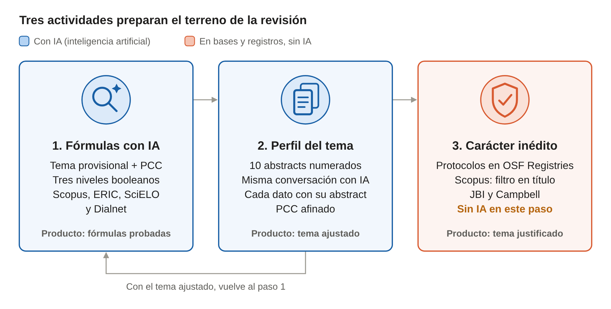

# Actividades preparatorias para una revisión de alcance

Nov 8, 2026 · @JH

Antes de redactar una revisión de alcance (scoping review), el estudiante prepara el terreno: 



## Paso 1. Construir fórmulas de búsqueda con IA

El estudiante entrega su tema provisional a una IA y obtiene fórmulas booleanas adaptadas a cada base.

**Tema provisional del caso:** retroalimentación con IA (inteligencia artificial) en la escritura académica de estudiantes universitarios.

| Elemento PCC (Población, Concepto, Contexto) | Contenido en el caso |
| --- | --- |
| Población | Estudiantes universitarios de pregrado |
| Concepto | Retroalimentación generada por IA (inteligencia artificial) a textos escritos |
| Contexto | Cursos de escritura académica en educación superior |

### Prompt modelo

```markdown
Actúa como especialista en revisiones de alcance (scoping reviews) en educación.
Mi tema provisional es "Retroalimentación con inteligencia artificial en la escritura académica de estudiantes universitarios".
1. Desglosa el tema según el marco PCC (Población, Concepto, Contexto).
2. Para cada elemento, propón sinónimos en inglés, español y portugués.
3. Genera fórmulas booleanas con campos, truncamiento, filtros y NOT.
4. Adapta la sintaxis de Scopus, ERIC, SciELO y Dialnet.
```

### Ejemplo de fórmulas

**Scopus

```
TITLE-ABS-KEY ( ( "artificial intelligence" OR "generative AI" OR "large language model*" OR chatgpt OR "automated writing evaluation" )
AND ( feedback OR "formative assessment" OR revision* )
AND ( "academic writing" OR "writing skill*" OR essay* OR "L2 writing" )
AND ( universit* OR undergraduate* OR "higher education" OR college ) )
AND NOT TITLE-ABS-KEY ( "secondary school" OR "primary school" )
AND PUBYEAR > 2017
AND ( LIMIT-TO ( DOCTYPE , "ar" ) )
AND ( LIMIT-TO ( LANGUAGE , "English" ) OR LIMIT-TO ( LANGUAGE , "Spanish" ) )
```

**ERIC (Education Resources Information Center).** 
```
(descriptor:"Artificial Intelligence" OR "generative AI" OR ChatGPT OR "automated writing evaluation")
AND (descriptor:"Feedback (Response)" OR "automated feedback")
AND (descriptor:"Writing Instruction" OR descriptor:"Writing Evaluation" OR "academic writing")
AND descriptor:"Higher Education"
```

**SciELO (Scientific Electronic Library Online).** 
```
("inteligencia artificial" OR "inteligência artificial" OR "artificial intelligence" OR ChatGPT)
AND (retroalimentación OR feedback OR "evaluación formativa")
AND ("escritura académica" OR "redacción académica" OR "escrita acadêmica" OR "academic writing")
AND (universit$ OR "educación superior" OR "ensino superior")
```

**Dialnet.** Su buscador admite poca sintaxis booleana; funciona mejor con dos o tres búsquedas cortas entre comillas y los filtros de la búsqueda avanzada (artículos de revista, materia Educación, años).
```
"inteligencia artificial" "escritura académica" retroalimentación
"ChatGPT" "redacción académica" universitarios
```

### Cómo leer los resultados

| Resultados de la fórmula | Decisión |
| --- | --- |
| Más de 2000 | Subir de nivel: más campos, filtros o NOT |
| Entre 100 y 2000 | Fórmula adecuada para explorar el tema |
| Menos de 30 | Bajar de nivel o sumar sinónimos con OR |

## Paso 2. Perfilar el tema con los abstracts

El estudiante pega al menos 10 abstracts en la misma conversación del paso 1, y la IA ajusta el tema a lo que la literatura realmente estudia.

### Prompt modelo

```markdown
Te comparto 10 abstracts numerados que obtuve con las fórmulas anteriores.
A partir de ellos:
1. Identifica la población, el concepto y el contexto que más se repiten.
2. Propón una versión ajustada de mi tema y de su PCC (Población, Concepto, Contexto).
3. Indica el número del abstract que respalda cada afirmación.
No agregues información que no esté en los abstracts.

[Abstract 1] Referencia APA + resumen
[Abstract 2] ...
```

### Ejemplo de respuesta (ilustrativo)

Supongamos que la IA (inteligencia artificial) devuelve estos hallazgos sobre los 10 abstracts del caso:

- La mayoría estudia ChatGPT y sistemas AWE (automated writing evaluation, evaluación automatizada de la escritura) con estudiantes de inglés como lengua extranjera.
- Predominan las encuestas de percepción; pocos estudios observan si el estudiante corrige su texto después de la retroalimentación.
- Casi no hay estudios en español ni en universidades latinoamericanas.
- Términos nuevos para las fórmulas: *feedback uptake*, *AI-generated feedback*, *revision behavior*.

### Tema antes y después

|  | Tema provisional | Tema ajustado |
| --- | --- | --- |
| Enunciado | Retroalimentación con IA en la escritura académica de universitarios | Retroalimentación generada por IA y revisión de textos académicos en estudiantes universitarios: mapa de la evidencia 2018-2025 |
| Población | Estudiantes universitarios | Estudiantes universitarios de pregrado, en lengua materna o extranjera |
| Concepto | Retroalimentación con IA | Retroalimentación generada por IA y su incorporación en la revisión del texto |
| Contexto | Escritura académica | Cursos de escritura académica en educación superior |

Con el tema ajustado, el estudiante vuelve al paso 1 y agrega los términos nuevos al nivel 3 de sus fórmulas.

## Paso 3. Verificar el carácter inédito

El tema es inédito si no existe una revisión publicada ni un protocolo registrado con el mismo PCC (Población, Concepto, Contexto). Este paso se hace directamente en las bases y registros.

### Preservación de la originalidad

1. Actualización temporal: por ejemplo, si existe una revisión con cierta antigüedad, la nueva actualizaría el contenido.
2. Modificación del marco: por ejemplo, si una investigación se realiza en población adulta, esta vez se ejecuta sobre población infantil.
3. Ampliación de fuentes y rigor metodológico: por ejemplo, si una revisión buscó solo en una base, la nueve puede buscar en más bases.

### ¿Cómo verificar la existencia de una revisión previa?
#### Verifica protocolos
1. PROSPERO
2. OSF 
3. ResearchResgistry
4. Figshare
#### Búsqueda de revisiones ya publicadas
1. Epistemonikos
2. PubMed / MEDLINE
3. Embase
4. Scopus
5. Web of Science
6. Google Scholar

